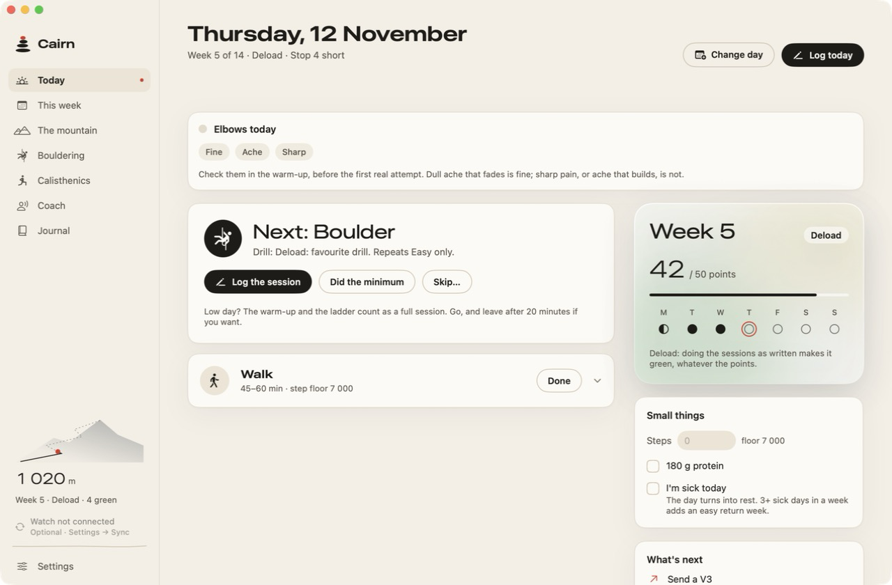
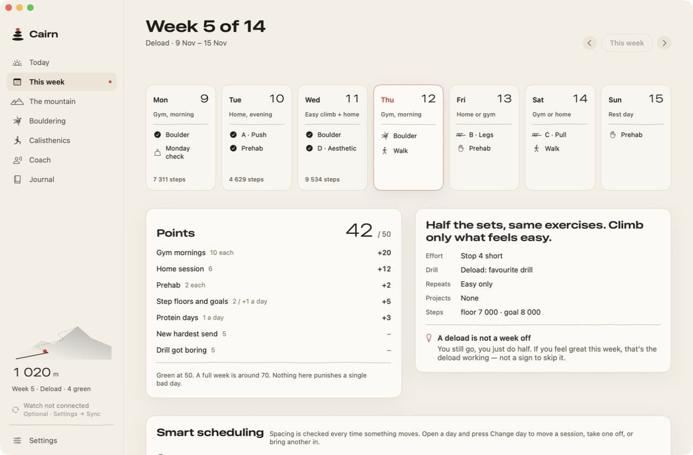
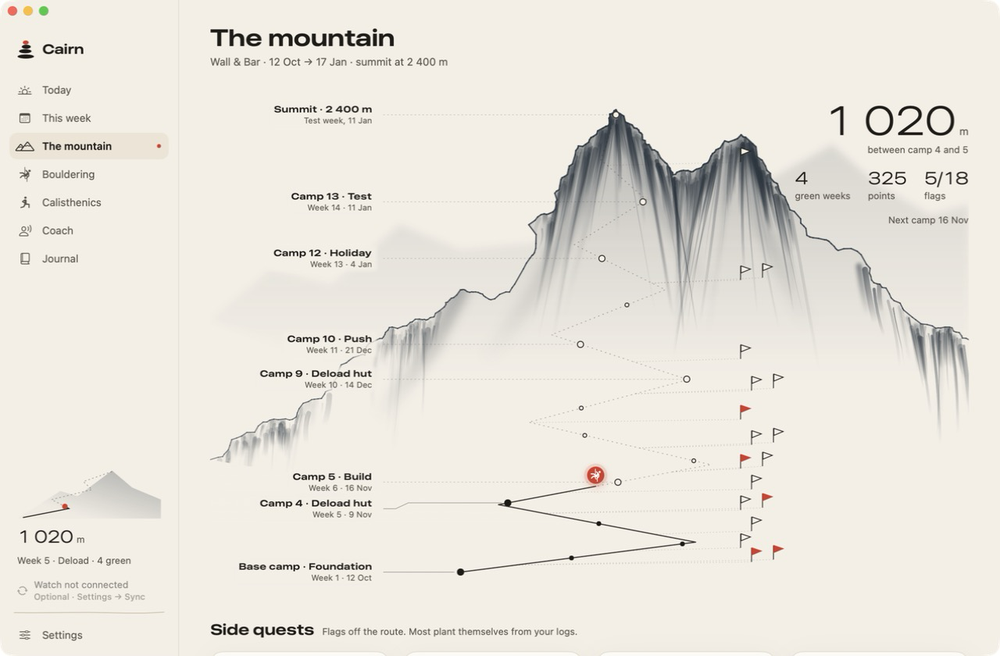

# Cairn

Cairn is a training app for macOS and iPhone. It runs a 14-week block that combines bouldering with calisthenics and draws the block as a mountain: each week is a camp, and every logged session moves a marker up the route.

The app ships with one default plan, "Wall & Bar", and everything in it can be edited. Your log lives in a single JSON file on your own machine. There are no accounts, no analytics and no servers.

<p>
  
  
  
</p>

The screenshots use generated demo data.

## What it does

- **Logs sessions where you do them.** Climbs are logged one send at a time by grade. Strength sets are prefilled from the last session, so a normal day is a few taps.
- **Adapts the plan.** If a week ends with two or more missed gym days (sick days excluded), the week repeats and the rest of the block slides back seven days. Three or more sick days add an easy return week first. Every change can be undone.
- **Applies double progression.** When all sets reach the top of the rep range, the load goes up a step and the reps return to the bottom of the range. Resistance bands are stacked from a set of five, and the app steps through the combinations in order of total resistance.
- **Tracks skills.** Calisthenics skills are ladders. The harder skills, such as the dragon flag and the planche, stay locked until their prerequisites are met.
- **Handles grades your way.** Use the V scale, the Font scale, or your gym's colour circuits. Old logs convert when you switch.
- **Keeps profiles apart.** Each profile has its own plan, log and settings.
- **Syncs with an iPhone app** over local Wi-Fi, with no cloud in between. This is optional and off by default.
- **Optionally asks a coach.** A weekly or daily check-in sends a summary of your log to the Claude Code command-line tool installed on your Mac and returns suggested changes. You approve each one. It is off until you run a check-in.
- **Optionally imports watch activities** from a folder of exported JSON. See [docs/ACTIVITY-IMPORT.md](docs/ACTIVITY-IMPORT.md).

## Requirements

| | Mac | iPhone |
|---|---|---|
| Hardware | Apple silicon | Any iPhone that runs iOS 17 |
| OS | macOS 14 or later | iOS 17 or later |
| Tools | Xcode Command Line Tools (Swift 5.9 or later) | Xcode, and an Apple ID signed in to it |

There is no prebuilt download. Cairn is built from source, which takes about a minute on the Mac.

## Build and run

```bash
git clone https://github.com/adam-dev-haven/cairn.git
cd cairn
./build.sh
open Cairn.app
```

`build.sh` produces an ad-hoc signed `Cairn.app` in the project folder. On first launch Cairn creates an empty profile named after your macOS account and starts the block on the nearest Monday: today if it is a Monday, otherwise the next one. Nothing is pre-filled.

The bundle identifier defaults to `com.example.cairn`. To use your own, run `CAIRN_BUNDLE_ID=com.yourname.cairn ./build.sh`.

Step-by-step installation, first-run notes, the iPhone install and troubleshooting are in [docs/GETTING-STARTED.md](docs/GETTING-STARTED.md).

## Your data

| What | Where |
|---|---|
| Log, plan and settings | `~/Library/Application Support/Cairn/cairn.json` |
| Backups | One per day next to the log, the last 14 kept |
| Coach reports and snapshots | `~/Library/Application Support/Cairn/coach/` |

If the log file cannot be read, Cairn copies it aside and refuses to write over it. Settings → Sync has an export button and a "Show in Finder" button.

Cairn makes no network requests of its own. The only things that touch a network are the optional iPhone sync (local Wi-Fi only) and the optional coach, which runs the `claude` program you already have installed. See [SECURITY.md](SECURITY.md) for what is sent where and for the limits of the sync protocol.

## Tests

The app contains a headless test suite. Point it at a scratch folder so it never touches your own log:

```bash
swift build -c release --arch arm64
CAIRN_DATA_DIR="$(mktemp -d)" .build/release/Cairn --selftest
```

The suite covers plan adaptation, scoring, progression, merging of two devices' logs, the activity import, the coach round trip against a stand-in `claude`, and the sync guard. It prints `selftest: N passed, 0 failed` and exits non-zero on any failure.

Other environment variables for development: `CAIRN_NOW=2026-11-12` pins the clock, `CAIRN_DEMO=1` fills an empty store with synthetic logs, and `CAIRN_SECTION=mountain` opens a given page.

## Project layout

```
Sources/Cairn/
  Model/    Plan, log, merge, progression, scheduling, coach, sync (no UI code)
  UI/       SwiftUI screens shared by Mac and iPhone
  Mac/      App entry point, menus, sidebar, icon drawing
  Phone/    iPhone shell and pairing screens
  SelfTest*.swift   The test suite
ios/        Xcode project that compiles the same sources for the iPhone
Training/   Generator for the exercise library (data.py, gen_swift.py)
docs/       Getting started, activity import format, architecture, credits
```

The Mac and iPhone apps compile the same `Sources/Cairn` folder. [docs/ARCHITECTURE.md](docs/ARCHITECTURE.md) describes how the data model, the merge and the sync fit together. The visual language is recorded in [DESIGN.md](DESIGN.md).

## Credits and licence

Cairn is released under the [MIT licence](LICENSE). The MIT licence covers the source code only. The exercise photographs have their own terms, and they and the sources behind the training content are credited in [docs/CREDITS.md](docs/CREDITS.md). Cairn is a logging and planning tool, not medical advice. Stop a session if something hurts.
